<div align="center">

# 🎧 SoundPulse
### End-to-End Machine Learning on 114,000 Spotify Tracks

**From raw audio features to explainable predictions — data preparation, anomaly detection, clustering, deep learning, regression and imbalanced learning in one pipeline.**

---

**Author:** Giuseppe Muschetta<br>
**University:** University of Pisa<br>
**Degree:** M.Sc. in Data Science & Business Informatics

---

[](https://www.python.org/)
[](https://scikit-learn.org/)
[](https://www.tensorflow.org/)
[](https://xgboost.ai/)
[](https://shap.readthedocs.io/)
[](https://imbalanced-learn.org/)
[-000000?logo=apple&logoColor=white)](#-engineering-highlights)
[](LICENSE)

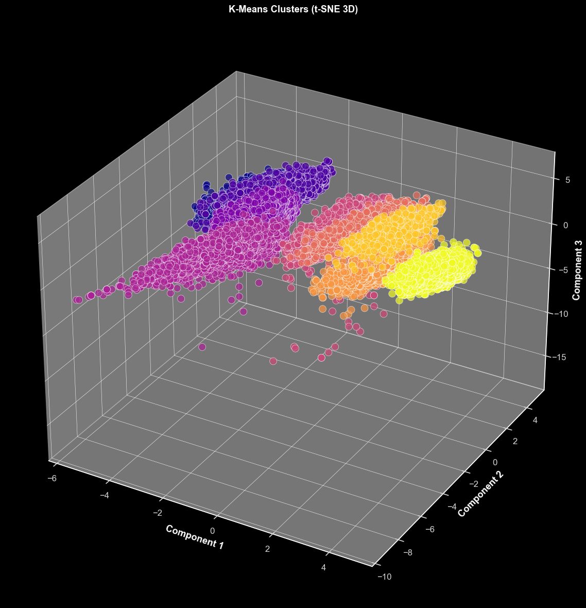

</div>

---

## ✨ At a glance

<div align="center">

| 🎵 **114,000** tracks | 🏷️ **114 → 10** genres | 🧠 **4.6 M**-parameter deep net | 📓 **6** notebooks |
|:---:|:---:|:---:|:---:|
| **97.5 %** cluster-recovery accuracy | **0.90** macro ROC-AUC on 10 genres | **18×** R² gain over linear models | **+59 %** minority-class recall with SMOTE |

</div>

SoundPulse takes a public Spotify catalogue of 114,000 tracks and runs it through the **full data-science lifecycle**. Each stage is a self-contained notebook that writes a clean dataset for the next one:

> **Understand → Clean → Discover → Classify → Explain → Predict → Rebalance**

The models answer four concrete questions:

1. **Which tracks are anomalous?** → Local Outlier Factor flags and removes the 5 % least typical tracks.
2. **What natural "sound families" exist?** → K-Means finds 9 segments, and three different classifiers confirm they are real and separable.
3. **Can audio features alone tell you the genre?** → A Random Forest and a custom residual deep network classify tracks into 10 macro-genres. SHAP and gradient attribution explain *why*.
4. **Can we predict popularity, and spot explicit content?** → Tree ensembles beat linear baselines by 18× in R², and SMOTE pipelines raise recall on the rare *explicit* class.

---

## 📚 Table of contents

- [Pipeline architecture](#-pipeline-architecture)
- [1 · Data understanding & preparation](#1--data-understanding--preparation)
- [2 · Outlier detection](#2--outlier-detection-with-local-outlier-factor)
- [3 · Clustering](#3--clustering-discovering-latent-sound-families)
- [4 · Genre classification & explainability](#4--10-class-genre-classification--explainability)
- [5 · Popularity regression](#5--popularity-regression)
- [6 · Imbalanced learning](#6--imbalanced-learning-predicting-explicit-content)
- [Results scoreboard](#-results-scoreboard)
- [Key insights](#-key-insights)
- [Engineering highlights](#-engineering-highlights)
- [Repository structure](#-repository-structure)
- [Getting started](#-getting-started)
- [Roadmap](#-roadmap)
- [About the author](#-about-the-author)

---

## 🗺️ Pipeline architecture

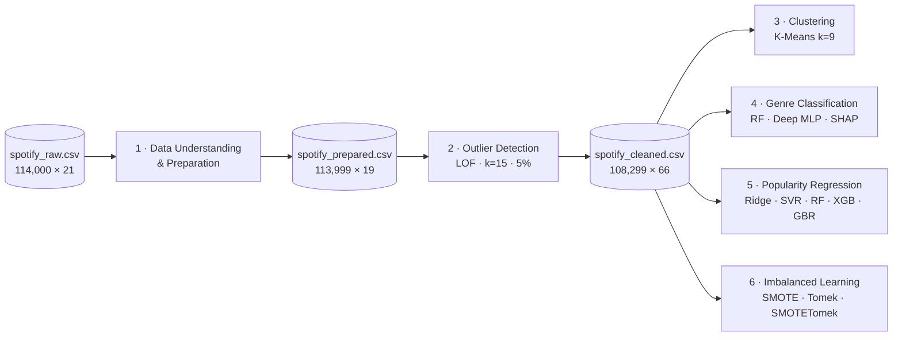

| # | Notebook | Purpose | Main techniques |
|:-:|---|---|---|
| 1 | [`1_data_understanding_and_preparation.ipynb`](1_data_understanding_and_preparation.ipynb) | EDA, feature engineering, genre taxonomy | Distributions, Pearson & Spearman, 114 → 10 genre mapping |
| 2 | [`2_outlier_detection.ipynb`](2_outlier_detection.ipynb) | Data-quality screening | One-Hot + Standardization, k-distance elbow, **LOF**, PCA |
| 3 | [`3_clustering.ipynb`](3_clustering.ipynb) | Latent segment discovery | **K-Means** (elbow + silhouette), PCA 2D/3D, NN / Decision Tree validation |
| 4 | [`4_classification_explainability.ipynb`](4_classification_explainability.ipynb) | 10-class genre prediction | **Random Forest**, **residual deep MLP**, **SHAP**, permutation & gradient importance |
| 5 | [`5_regression.ipynb`](5_regression.ipynb) | Popularity forecasting | Ridge, Linear SVR, **Random Forest**, **XGBoost**, Gradient Boosting |
| 6 | [`6_imbalanced_learning.ipynb`](6_imbalanced_learning.ipynb) | Explicit-content detection (91 / 9 split) | **SMOTE**, Tomek Links, Random Under-Sampling, **SMOTETomek** |

---

## 1 · Data understanding & preparation

**Dataset.** 114,000 tracks × 21 columns: 1,000 tracks for each of 114 Spotify genres. Each track has metadata (artists, album, track name, popularity, explicit flag) and Spotify's audio descriptors (`danceability`, `energy`, `loudness`, `speechiness`, `acousticness`, `instrumentalness`, `liveness`, `valence`, `tempo`, `key`, `mode`, `time_signature`, `duration_ms`).

**What was done**

- 🧹 **Cleaning.** Removed the single row with missing metadata, plus the technical columns `Unnamed: 0` and `track_id`.
- 🎼 **Musical feature engineering.** Merged `key` (0–11) and `mode` (0/1) into one readable **`keymode`** feature such as *"C# minor"* or *"A major"*, with 24 possible values.
- ⏱️ Converted `duration_ms` → **`duration_mins`**, cast `explicit` to a binary integer and renamed `track_genre` → `genres`.
- 🏷️ **Genre taxonomy design.** Hand-built a semantic mapping that compresses **114 raw genres into 10 macro-categories**. For example, *metal / black-metal / death-metal / grindcore / metalcore* become **Metal & Hardcore**, and *k-pop / j-pop / anime / cantopop / afrobeat / reggae* become **World & Regional**.

<p align="center">
  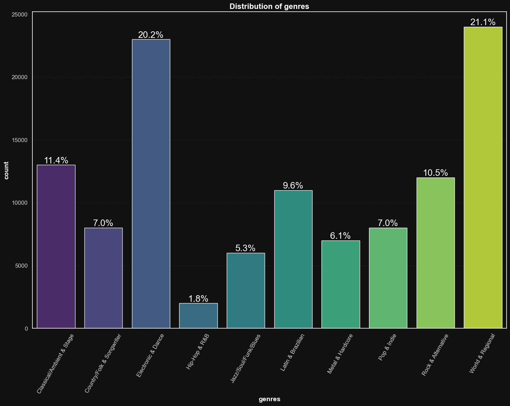
</p>

The resulting target is realistically **imbalanced**: *World & Regional* (21.1 %) and *Electronic & Dance* (20.2 %) dominate, while *Hip-Hop & R&B* has only 1.8 % of the tracks. This is a deliberate challenge for every classifier that follows.

<p align="center">
  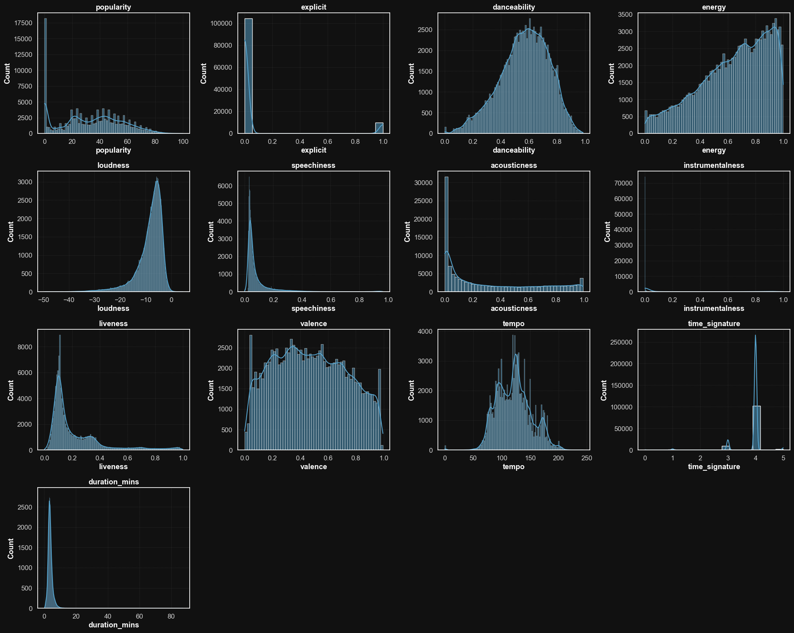
  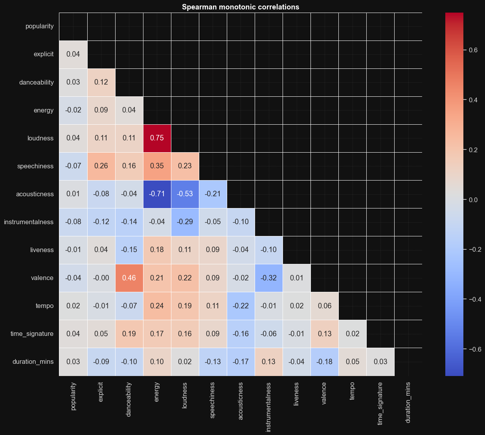
</p>

**EDA takeaways**

- `popularity` has a large spike at **(near) zero**: a sizeable share of the catalogue has essentially no plays.
- `instrumentalness`, `speechiness` and `liveness` are heavily right-skewed. `acousticness` is bimodal.
- The strongest monotonic relations are **energy ↔ loudness (ρ = 0.75)** and **energy ↔ acousticness (ρ = −0.71)**. These are physically meaningful, because loud tracks are energetic and acoustic tracks are quiet.
- Popularity has **almost no monotonic correlation (|ρ| ≤ 0.08)** with any single audio feature. This already suggests that popularity can only be modelled through non-linear interactions, which Notebook 5 confirms.

---

## 2 · Outlier detection with Local Outlier Factor

**Feature space.** 13 standardized numeric features plus one-hot `keymode` and `genres_10` give **47 dimensions**.

**Choosing `n_neighbors` without guessing.** A single `NearestNeighbors` fit (k = 100) yields the average distance to the k-th neighbour for every k. The knee of that curve sets **k = 15**.

**Detection.** `LocalOutlierFactor(n_neighbors=15, contamination=0.05)` flags **5,700 tracks (5.00 %)**. The most extreme ones are interpretable:

- tracks with **zero popularity** sitting among very popular look-alikes, such as a Kid Cudi and a Wiz Khalifa track on compilation albums;
- **exact duplicates** of the same song listed under three different genres (*folk*, *songwriter*, *singer-songwriter*), a classic data-quality issue.

<p align="center">
  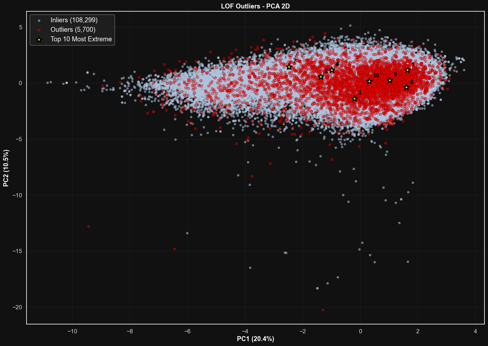
</p>

The ⭐ markers are the top 10 most anomalous tracks. Many outliers are *local* anomalies inside dense regions, not just global extremes. This is exactly what LOF captures and what a simple z-score would miss.

➡️ Output: **`spotify_cleaned.csv`**, 108,299 tracks × 66 engineered columns, used by every downstream notebook.

---

## 3 · Clustering: discovering latent "sound families"

**K-Means** (`k-means++`, Elkan) was fitted for k = 2…50 (inertia) and k = 2…30 (silhouette on a 20k sample). Local maxima of the silhouette curve were then detected automatically.

<p align="center">
  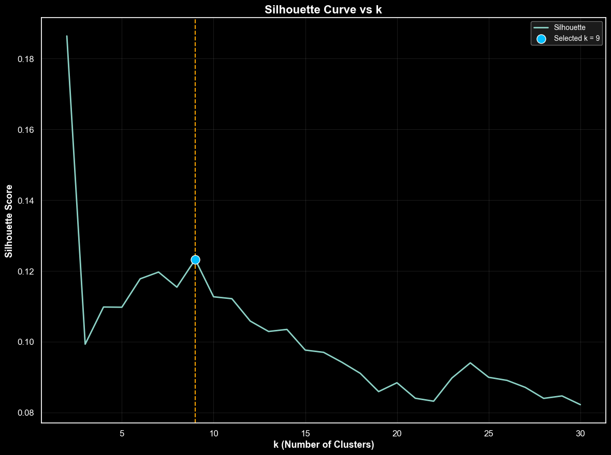
  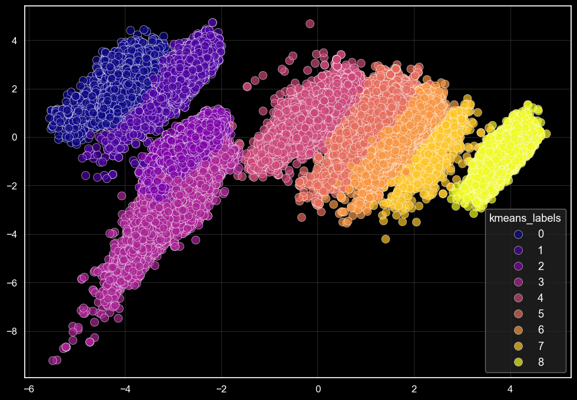
</p>

**k = 9** is the best non-trivial local maximum (silhouette 0.123), and it agrees with the elbow region of the inertia curve. The PCA projection shows **9 well-ordered, contiguous bands** that run from acoustic/instrumental tracks (left) to high-energy produced tracks (right).

### Are the clusters real? Two independent checks

Clusters that a supervised model can recover from the raw features are not artefacts of the algorithm. Two classifiers were trained to predict the cluster label:

| Validator | Test accuracy | Notes |
|---|:---:|---|
| **Deep neural network** (512→256→128→64, Swish, BatchNorm, AdamW) | **97.47 %** | Balanced acc. 98.0 %, Cohen's κ 0.970, MCC 0.970 |
| **Decision Tree** (GridSearch over 2,940 configs × 5-fold CV) | **92.58 %** | Macro-F1 0.927, fully interpretable rules |

<p align="center">
  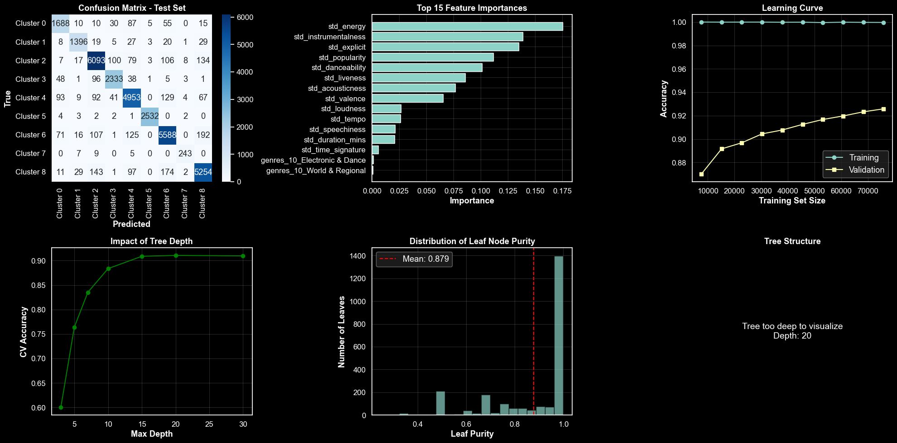
</p>

The tree shows **which features define the segments**: `energy`, `instrumentalness`, `explicit`, `popularity` and `danceability`. This gives each cluster a direct business reading, for example *"high-energy explicit tracks"* versus *"quiet instrumental tracks"*.

---

## 4 · 10-class genre classification & explainability

**Task:** predict 1 of 10 macro-genres from **only 13 standardized audio/meta features**, with a 70/30 stratified split (75,809 train / 32,490 test).

### 🌲 Model A: Random Forest (tuned)

`GridSearchCV` over **160 configurations × 5-fold stratified CV** (800 fits), optimizing **macro-F1** with `class_weight="balanced"`.

| Metric | Score |
|---|:---:|
| Accuracy | **58.5 %** (random guess 10 %, majority class 21 %) |
| ROC-AUC OvR (macro / micro) | **0.898 / 0.917** |
| Macro-F1 · Balanced accuracy | 0.535 · 0.540 |
| Best per-genre AUC | Metal & Hardcore **0.954**, Latin & Brazilian **0.949** |

<p align="center">
  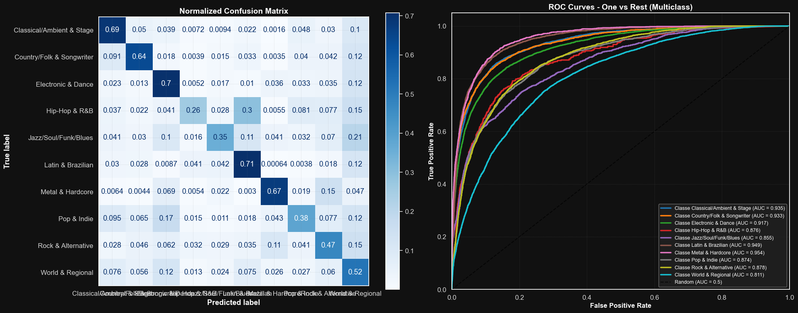
</p>

### 🧠 Model B: custom residual deep network (TensorFlow / Keras)

A deep network designed from scratch for tabular, imbalanced, multi-class data:

```text
Input(13)
 └─ Dense 1536 → LayerNorm → GELU → GaussianNoise(0.1) → Dropout 0.45
 └─ Residual block 768  (Dense → LN → GELU → Dropout → Dense → LN) ⊕ skip → GELU → Dropout 0.35
 └─ Sigmoid gating (attention-style) 768 ⊙ x
 └─ Dense 512 → LN → GELU → Dropout 0.30
 └─ Residual block 384  ⊕ skip → GELU → Dropout 0.20
 └─ Dense 256 → LN → GELU → AlphaDropout 0.15
 └─ Dense 128 → LN → GELU → Dropout 0.10
 └─ Dense 64  → LN → ReLU
 └─ Softmax(10)   with L1/L2 regularization
```

| Design choice | Setting |
|---|---|
| Parameters | **4,649,034** trainable |
| Optimizer | **AdamW** (lr 5e-4, weight decay 5e-5, `clipnorm=1.0`) |
| LR schedule | **10-epoch linear warm-up → cosine annealing**, plus `ReduceLROnPlateau` backup |
| Regularization | L2 3e-4 on every hidden layer, L1/L2 on output, decaying dropout 0.45 → 0.10, Gaussian noise |
| Imbalance handling | Balanced class weights **smoothed with a 0.75 power and re-normalized** to avoid extreme weights |
| Training | batch 4096, up to 350 epochs, `EarlyStopping(patience=35)`, best checkpoint restored (epoch 197) |
| Hardware | Apple **M3 Ultra GPU via TensorFlow-Metal**, 28 CPU cores |

<p align="center">
  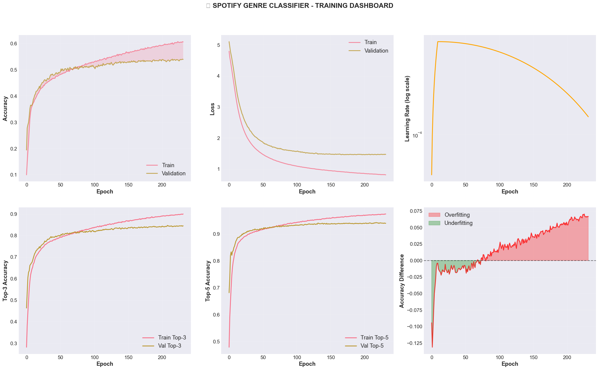
</p>

| Metric | Score |
|---|:---:|
| Top-1 accuracy | **53.6 %** |
| **Top-3 accuracy** | **84.1 %** |
| **Top-5 accuracy** | **94.1 %** |
| Macro recall | **0.542**, the highest of the two models |
| Mean confidence on correct vs wrong predictions | 0.74 vs 0.55, so the model is well calibrated about its own uncertainty |

<p align="center">
  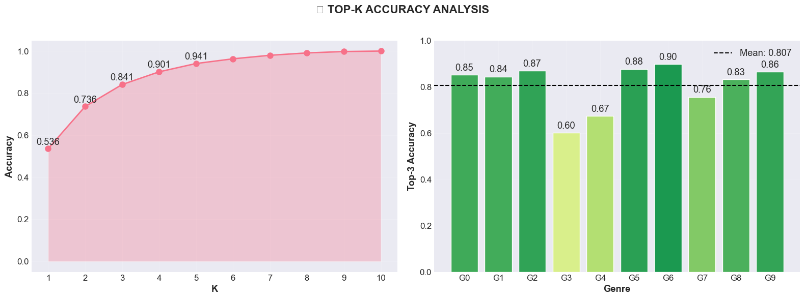
</p>

> **Why Top-K matters.** Genre boundaries are fuzzy: *indie-pop* vs *synth-pop*, *latin* vs *reggaeton*. For a recommender or a playlist-tagging assistant, the right genre in the **top 3 suggestions 84 % of the time** is a strong, product-ready result.

<p align="center">
  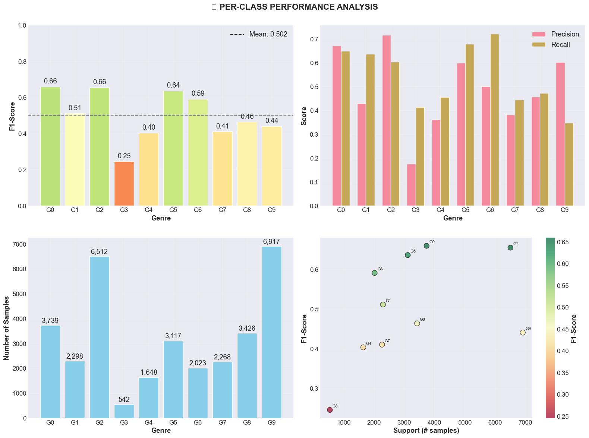
</p>

### 🔍 Explainability: opening both black boxes

**Deep network: permutation and gradient attribution**

<p align="center">
  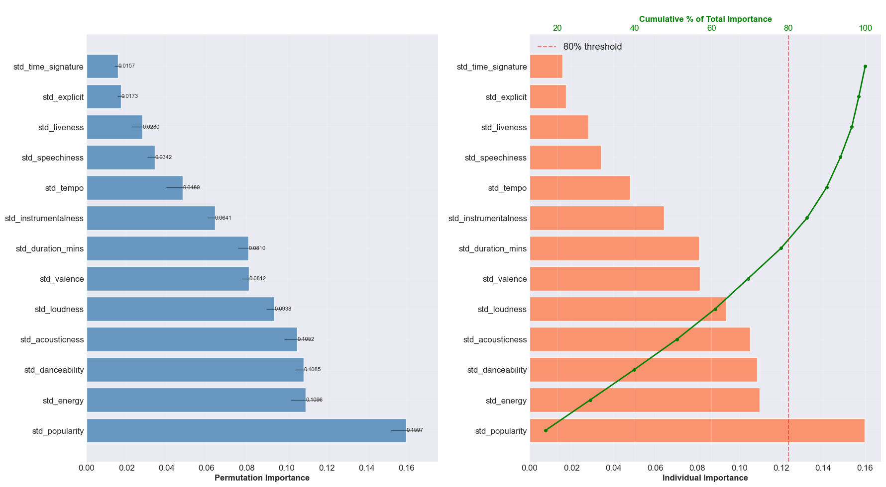
  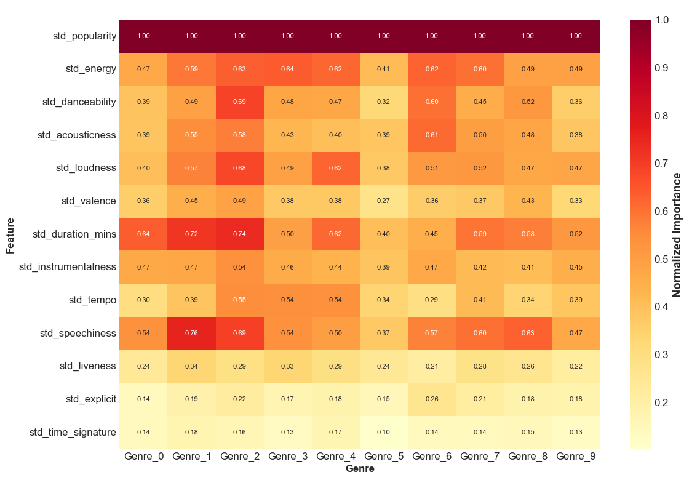
</p>

- **Permutation importance** (5 repeats): `popularity`, `energy`, `danceability`, `acousticness` and `loudness` drive the network. The **top 8 features explain 80 %** of its decisions.
- **Gradient-based saliency per genre** (∂p(genre)/∂x via `tf.GradientTape`) shows *genre-specific* sensitivities. Electronic & Dance reacts strongly to `danceability`, `loudness` and `duration`. Country/Folk reacts most to `speechiness`.

**Random Forest: SHAP (TreeExplainer)**

<p align="center">
  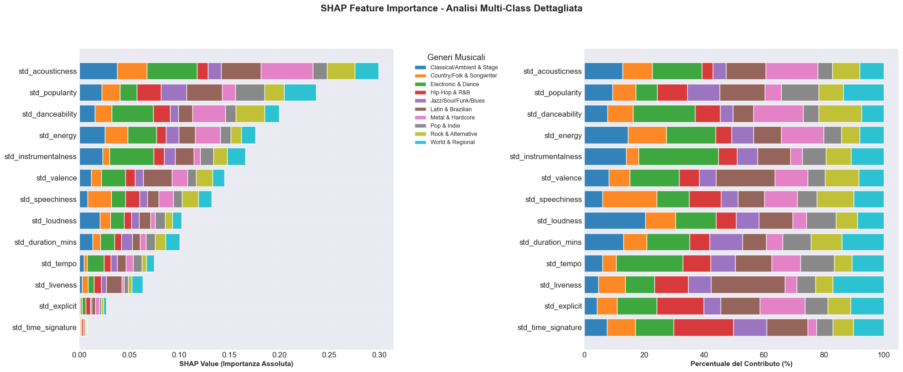
</p>

SHAP values were computed for every class (500 × 13 × 10 tensor) and shown as stacked contributions per genre. **`acousticness`** is the strongest global separator and the top feature for 5 of the 10 genres, including Metal, Electronic, Classical and Latin.

<p align="center">
  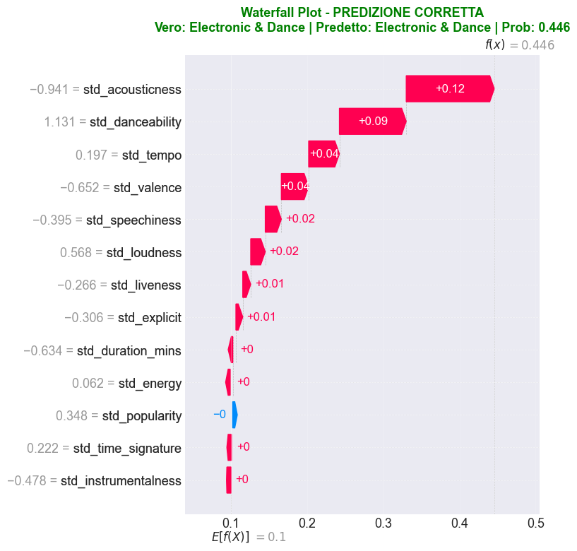
</p>

**Local explanation.** For a correctly classified *Electronic & Dance* track, low acousticness (+0.12) and high danceability (+0.09) raise the probability from a 0.10 base rate to 0.45. The notebook also explains a *mis*-classified Hip-Hop track, which helps debug where the model fails.

---

## 5 · Popularity regression

**Task:** predict the (standardized) Spotify popularity score from 12 audio features. Every non-linear model was tuned with **`RepeatedKFold` (5 folds × 2 repeats)** and multi-metric scoring (R², RMSE, MAE), refitting on R².

| Model | Test R² | Test RMSE | Test MAE | CV R² |
|---|:---:|:---:|:---:|:---:|
| Ridge (Tikhonov) | 0.029 | 0.975 | 0.809 | n/a |
| Linear SVR | 0.014 | 0.982 | 0.802 | n/a |
| XGBoost | 0.508 | 0.694 | 0.454 | 0.468 |
| Gradient Boosting | 0.522 | 0.684 | **0.440** | 0.483 |
| 🏆 **Random Forest (800 trees)** | **0.529** | **0.679** | 0.488 | **0.492** |

The Random Forest's out-of-bag R² is 0.531, which confirms the test score.

<p align="center">
  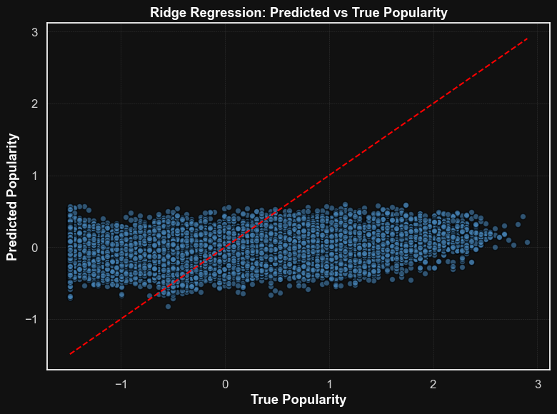
  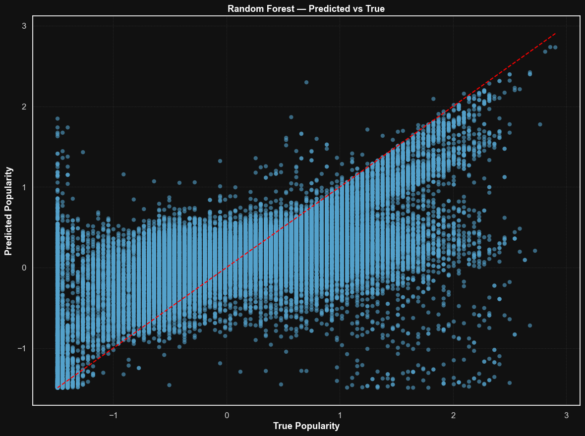
</p>

**The plots show the difference:** the linear model collapses into a flat band and predicts the mean for every track. The Random Forest follows the diagonal. Moving from linear to ensemble models gives an **≈ 18× gain in R²** (0.029 → 0.529), which shows that popularity is driven by *interactions* between audio features, not by any single one.

<p align="center">
  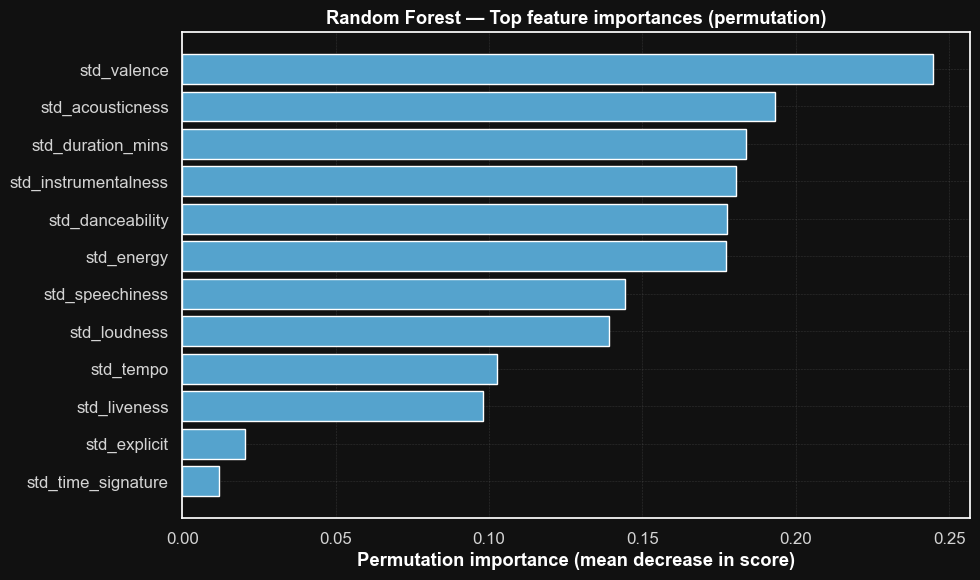
  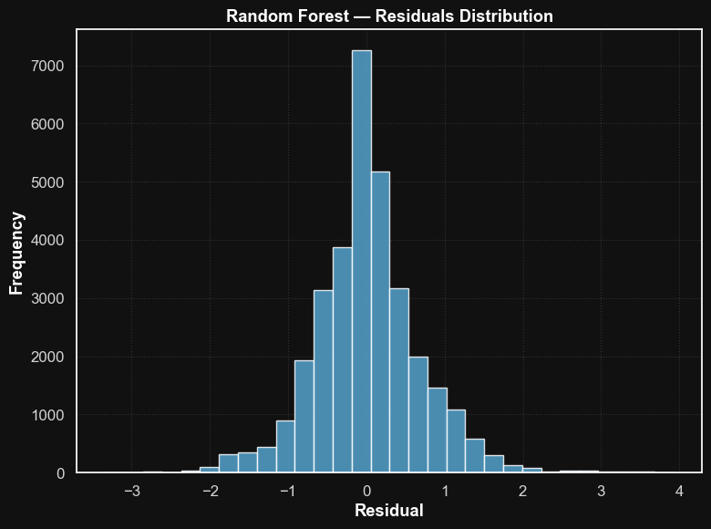
</p>

`valence`, `acousticness`, `duration`, `instrumentalness` and `danceability` are the strongest popularity drivers. Residuals are centred on zero and symmetric, with no systematic bias.

---

## 6 · Imbalanced learning: predicting explicit content

**Task:** binary classification of the `explicit` flag, with **99,181 clean vs 9,118 explicit tracks (≈ 91 / 9)**. A model that always says "not explicit" already scores 91 % accuracy, so accuracy is ignored and every pipeline is optimized and compared on **macro-F1**, **minority-class recall** and **ROC-AUC**.

All resampling is done **inside `imblearn.Pipeline`** and therefore only on the training folds. This prevents synthetic samples from leaking into validation.

| Technique | Macro-F1 | Macro Precision | Macro Recall | ROC-AUC | **Recall (explicit)** | Precision (explicit) |
|---|:---:|:---:|:---:|:---:|:---:|:---:|
| Baseline RF (no balancing) | 0.760 | **0.924** | 0.695 | **0.945** | 0.395 | **0.901** |
| 🏆 **SMOTE + RF** | **0.795** | 0.794 | 0.796 | 0.941 | 0.628 | 0.622 |
| Tomek Links + Under-sampling + RF | 0.669 | 0.643 | **0.842** | 0.924 | **0.870** | 0.300 |
| SMOTETomek + RF | 0.795 | 0.794 | 0.795 | 0.941 | 0.625 | 0.623 |

<p align="center">
  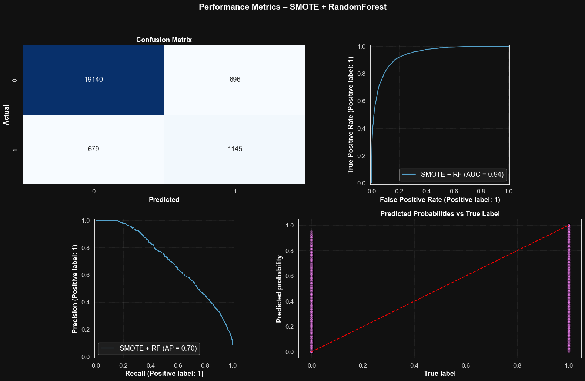
  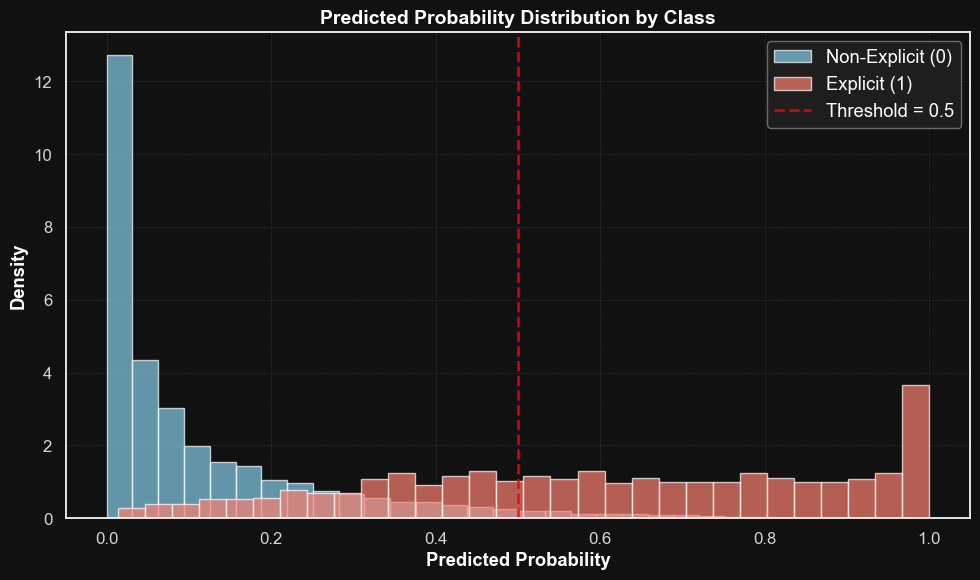
</p>

**Result:** SMOTE raises explicit-track recall from **39.5 % → 62.8 % (+59 % relative)** and macro-F1 from **0.760 → 0.795**, for a negligible −0.4 pt ROC-AUC. The notebook also gives a **use-case guide**:

- **SMOTE** is the best general trade-off.
- **Tomek + under-sampling** suits cases where a missed positive is very costly, such as parental-control filters (87 % recall).
- The **baseline** suits cases where false alarms must be minimal.

---

## 🏆 Results scoreboard

| Task | Best model | Headline result |
|---|---|---|
| Outlier detection | LOF (k = 15) | 5,700 anomalous / duplicate tracks removed |
| Cluster discovery | K-Means (k = 9) | Clusters recovered with **97.5 %** accuracy by a neural validator |
| Genre classification (10 classes) | Random Forest | **58.5 %** accuracy (5.8× random), **0.90** macro ROC-AUC |
| Genre suggestion | Residual deep MLP | **84.1 % Top-3** / **94.1 % Top-5** accuracy |
| Popularity regression | Random Forest (800 trees) | **R² = 0.53**, 18× the linear baseline |
| Explicit-content detection | SMOTE + Random Forest | **0.795 macro-F1**, minority recall +59 % |

---

## 💡 Key insights

1. **Sound is a strong but imperfect proxy for genre.** Audio-only features separate acoustically distinct families very well, such as Metal (AUC 0.95), Latin (0.95) and Classical/Ambient (0.93). Genres defined by *culture or geography* rather than sound are much harder; "World & Regional" scores the lowest AUC (0.81).
2. **Hip-Hop & R&B is mostly confused with Latin & Brazilian.** This is musically plausible (reggaeton and trap share rhythmic DNA) and shows that the 10-class taxonomy has one natural overlap.
3. **Popularity is non-linear.** No single feature correlates with it (|ρ| ≤ 0.08), yet ensembles explain over half of its variance.
4. **Acousticness is the single most informative feature** for genre according to SHAP. `popularity` is the most important feature for the neural net, a sign that genre playlists in this catalogue have very different popularity profiles.
5. **The right imbalance strategy depends on the cost of each error.** This project measures the trade-off explicitly instead of picking one method by default.

---

## ⚙️ Engineering highlights

- **Leakage-aware design.** `duration_ms` was dropped after conversion, `explicit` was excluded from its own predictor set, `popularity` was excluded from the regression inputs, and resampling happens only inside CV folds.
- **Robust validation.** Stratified splits, `StratifiedKFold`, `RepeatedKFold`, OOB scores, train-vs-test gap monitoring and multi-metric scoring are used throughout.
- **Data-driven hyperparameters.** The k-distance elbow sets LOF's `n_neighbors`, automatic silhouette local-maxima detection sets *k*, and large grid searches tune the models (up to **14,700 fits** for the decision tree).
- **Modern deep-learning recipe.** Residual connections, LayerNorm, GELU, attention-style gating, AdamW, warm-up + cosine LR, gradient clipping, smoothed class weights, checkpointing and TensorBoard logging.
- **Explainability at three levels.** Global (permutation, SHAP mean |value|), per-class (SHAP stacked bars, gradient heatmaps) and per-prediction (SHAP waterfall, local impact bars).
- **Hardware-aware.** TensorFlow-Metal on an Apple **M3 Ultra** GPU (96 GB unified memory), with all CPU cores used for scikit-learn grid searches (`n_jobs=-1`).
- **Consistent visual identity.** One custom dark theme is shared by every notebook, giving publication-ready figures.

---

## 📁 Repository structure

```text
.
├── 1_data_understanding_and_preparation.ipynb   # EDA, keymode, 114 → 10 genre taxonomy
├── 2_outlier_detection.ipynb                    # OHE + scaling, k-distance elbow, LOF, PCA
├── 3_clustering.ipynb                           # K-Means, silhouette, PCA 2D/3D, NN & tree validation
├── 4_classification_explainability.ipynb        # Random Forest, residual deep MLP, SHAP, gradients
├── 5_regression.ipynb                           # Ridge, Linear SVR, RF, XGBoost, Gradient Boosting
├── 6_imbalanced_learning.ipynb                  # SMOTE, Tomek Links, under-sampling, SMOTETomek
├── assets/                                      # Figures used in this README
├── LICENSE
└── README.md
```

At runtime the notebooks also create `Dataset/` (intermediate CSVs), `plots_*/` folders (saved figures) and Keras checkpoints (`*.keras`).

---

## 🚀 Getting started

**1 · Get the data.** Download the public *Spotify Tracks Dataset* (114,000 tracks, 114 genres, available on Kaggle) and save it as:

```text
Dataset/spotify_raw.csv
```

**2 · Create the environment.**

```bash
conda create -n soundpulse python=3.10 -y
```

```bash
conda activate soundpulse
```

```bash
pip install numpy pandas matplotlib seaborn scikit-learn imbalanced-learn xgboost shap tensorflow jupyterlab
```

On Apple Silicon, also install `tensorflow-metal` to train on the GPU.

**3 · Run the notebooks in order.** Each one reads the CSV produced by the previous one:

```text
1 → spotify_prepared.csv → 2 → spotify_cleaned.csv → 3 · 4 · 5 · 6
```

```bash
jupyter lab
```

---

## 🧭 Roadmap

- [ ] Ordinal / Focal-loss variants of the deep classifier to further lift minority genres
- [ ] Threshold tuning and probability calibration for the explicit-content detector
- [ ] Hierarchical classification (macro-genre → sub-genre) using the 114 original labels
- [ ] Deduplicate cross-listed tracks before the train/test split
- [ ] Package the pipeline as a CLI and add a Streamlit dashboard for non-technical stakeholders

---

## 👤 About the author

<div align="center">

**Giuseppe Muschetta**<br>
M.Sc. in Data Science & Business Informatics, University of Pisa

[](https://github.com/peppe212)
[](https://www.linkedin.com/in/giuseppemuschetta/)
[](mailto:peppe212@gmail.com)

*Open to roles and collaborations in Data Science, Machine Learning and Explainable AI.*

</div>

---

## 📄 License

Released under the [MIT License](LICENSE) © 2025 Giuseppe Muschetta.

<div align="center">

⭐ **If you found this project useful or inspiring, consider giving it a star!** ⭐

</div>
